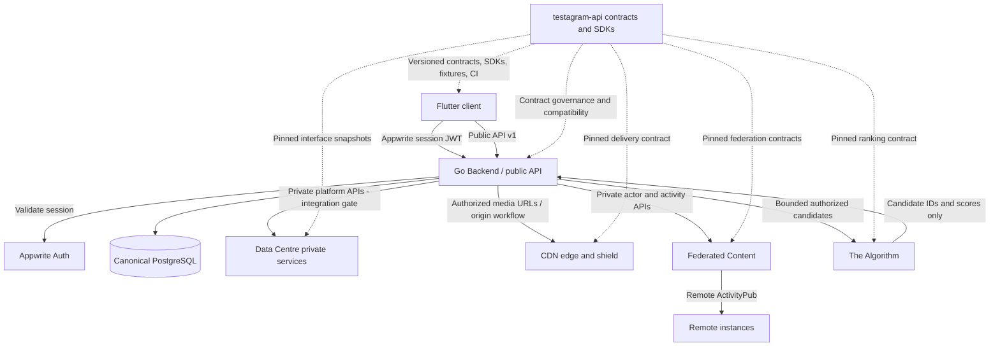

# Testagram seven-repository architecture (one API control plane + six runtime repositories)

Status: integration architecture and compatibility policy. This document does not authorize production cutover.

## The API repository's job

`testagram-api` is the **contract control plane**, not a seventh runtime service and not a second Go Backend. The system contains seven repositories total: this API control plane and six runtime repositories. It coordinates the interfaces shared by those six runtime repositories:

- machine-readable contracts and schemas;
- immutable upstream contract snapshots and provenance;
- client SDKs for public Backend routes;
- private service interface catalogues for Backend-owned service calls;
- compatibility checks, fixtures, examples and cross-repository CI;
- versioning, security and deprecation policy.

It must not proxy requests, own business data, store user credentials, execute ranking, process media, run federation workers, or become an alternate product database.

## Ownership and trust boundaries

| Repository | Owns | Permitted communication |
|---|---|---|
| [Testagram Backend](https://github.com/Trendyzima/Testagram-backend-) | Public product API, Appwrite JWT validation, canonical identity, authorization, PostgreSQL product records, media lifecycle and orchestration | Appwrite Auth; private Algorithm, Data Centre and Federation APIs; CDN media origins/URLs |
| [Flutter client](https://github.com/Trendyzima/testagram-flutter-client-) | Native UI, navigation, local UX state, device permissions and Appwrite session acquisition | Public Backend API only |
| [Data Centre](https://github.com/Trendyzima/Testagram-data-centre-) | Platform operations, storage nodes, video processing, notification delivery, backups and infrastructure control plane | Private Backend/platform network, storage providers and node agents |
| [CDN](https://github.com/Trendyzima/cdn-) | Public media byte delivery, HLS/DASH, cache, shield and edge routing | Media clients and configured origins; no product authorization |
| [Federated Content](https://github.com/Trendyzima/federated-content) | ActivityPub actors/keys, remote actor cache, signed inbox, protocol outbox and remote delivery | Public ActivityPub peers and private Backend API |
| [The Algorithm](https://github.com/Trendyzima/the-algorithm) | Stateless ranking over bounded candidate sets | Private Backend ranking API only |

**Single authority rule:** Backend owns local product identity, authorization, post state, visibility, blocks, media ownership and lifecycle. A projection, ranking response, CDN cache entry or federation activity never grants access.

## Communication topology

Dashed lines are governance/artifact relationships, not runtime traffic. The API repository is not in the request path and is not counted as a seventh runtime service.

## Runtime paths

### User requests
1. Flutter obtains a session JWT through the Appwrite Client SDK.
2. Flutter sends the JWT to the Backend public API.
3. Backend validates the JWT, resolves the canonical account and applies authorization.
4. Backend reads/writes canonical PostgreSQL state and orchestrates private services.
5. Flutter receives the Backend's public response. It never receives private service credentials.

### Feed ranking
1. Backend retrieves and filters a bounded candidate set using canonical product state.
2. Backend calls Algorithm `POST /v1/feed/rank` over the private network with a dedicated service bearer, API version and request ID.
3. Algorithm returns ordering/scores only and may return only IDs supplied in that request.
4. Backend validates the response, rechecks visibility/blocks/moderation, then hydrates canonical records.
5. Ranking failure follows Backend policy; the ranker cannot decide authorization.

### Media lifecycle and delivery
1. Backend authorizes upload intent, ownership, quota, visibility and retention.
2. Bytes are stored through the configured S3-compatible/object-storage boundary managed by the Backend/Data Centre deployment.
3. Data Centre video processing may produce HLS/DASH assets; its video service contracts remain distinct from the platform API.
4. Backend publishes the appropriate public URL or expiring private playback authorization. The CDN's current implementation fails open for asset authorization when `PLAYBACK_SECRET` is unset; private media is blocked until the CDN is corrected/configured to fail closed.
5. CDN serves bytes, manifests and ranges. CDN cache/purge operations never alter product ownership or authorization.
6. Deletion and retention originate in Backend; Data Centre performs durable storage operations and CDN invalidation is a delivery concern.

### Federation
1. Backend commits canonical product changes and a durable outbox event atomically.
2. Federation consumes authorized event/outbox data through private authenticated Backend interfaces.
3. Federation re-resolves actor eligibility and consent and persists protocol activities/delivery jobs.
4. Remote delivery is asynchronous, signed and retried independently.
5. Public inbox requests use ActivityPub HTTP Signatures, not Appwrite JWTs.
6. Backend remains authoritative for local blocks, visibility, deletion and federation preferences.

### Data Centre platform services

The platform listener on private port 8095 currently exposes health/readiness/metrics, feature configuration, event intake and audit intake. Its OpenAPI snapshot is included, but source audit found response/method/schema drift; see the [Data Centre conformance report](../integration/data-centre-platform-contract.md). The Backend's typed platform client and matching producer/consumer tests are not yet verified. Video and notification services are separately catalogued; do not assume the platform listener covers their APIs.

## Contract ownership and provenance

- Public Backend API contract: owned here as the cross-client public contract; Backend source remains the implementation authority.
- Algorithm, Data Centre and Federation provider contracts: provider repository remains authoritative. This repo pins exact provider commits and keeps read-only snapshots for review and code generation.
- CDN delivery semantics: source-audited route contract; provider code remains authoritative. Production hostname/origin remains an external deployment gate.
- Flutter: consumer, not a provider of product API contracts.
- Event schemas: owned by the domain that emits/consumes the event; snapshots here are immutable mirrors with source path and commit provenance.

Do not silently update snapshots to `main`. Update `contracts/sources.lock.json`, refresh snapshots deliberately, run all provider and consumer tests, then release a new compatible contract version.

## Current integration readiness

| Link | Current evidence | State |
|---|---|---|
| Flutter -> Backend | Appwrite JWT + public Backend routes; Dart SDK foundation | Contracted; app integration remains a consumer task |
| Backend -> Algorithm | Provider OpenAPI, Backend client and candidate-bound validation | Implemented interface; staging end-to-end still required |
| Backend -> Federation | Private activity ingress, separate directional tokens, outbox/poller/worker controls | Partial; workers and public routing remain gated |
| Backend -> Data Centre | Private platform OpenAPI and listener | Provider exists; Backend typed client/integration is a known gap |
| Backend -> CDN | Edge routes and media URL/delivery semantics | Route surface exists; origin, DNS, TLS and private playback need deployment verification |
| Data Centre -> video/notifications | Service catalogue and service endpoints | Catalogue-level only in this API repo; detailed contracts and consumer wiring remain to be audited |

## Explicit exclusions

- No second API server or generic API gateway runtime.
- No direct Flutter-to-Data-Centre, CDN purge, Federation-private or Algorithm calls.
- No Supabase, Redis/Valkey, Upstash or generic external queue runtime dependencies.
- No generic RPC that can invoke arbitrary internal capabilities.
- No assumption that health checks prove business workflows or media restore.
- No claim that unimplemented TV catalogue, marketplace, ads, wallet, admin or creator APIs exist because a UI screen exists.
