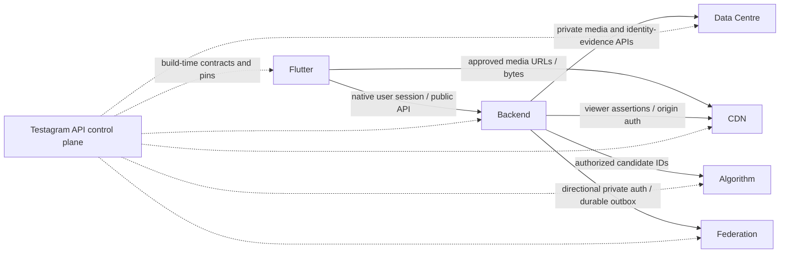

# Testagram seven-organ bridge

**Bridge branch:** `integration/seven-organ-bridge-20261120`  
**Control plane:** `Trendyzima/testagram-api`  
**Status:** Backend #424, Flutter #116 and API bridge #116 exact-head source CI have passed; live runtime acceptance remains pending.

This repository is the build-time governance layer, not a monorepo and not a runtime gateway. The six runtime organs remain independently owned repositories. The API Control Plane coordinates their contracts, immutable source pins, generated SDKs, route inventory and compatibility checks.

## 1. Seven organs and locked source revisions

| Organ | Repository | Locked source revision | Source status |
|---|---|---|---|
| Flutter client | [testagram-flutter-client-](https://github.com/Trendyzima/testagram-flutter-client-) | `e8fa65f321ad700c9e5f04fef86cd5604da500b0` | Open PR #116 candidate; includes deep links, social/knowledge, profile/wallet/monetization and the #117/#118/#120/#123 stacked feature work; exact-head CI passed, including the release-mode Android QA APK build; not in main |
| Backend | [Testagram-backend-](https://github.com/Trendyzima/Testagram-backend-) | `33844c9051b29e8b77ec4febc6c490e5dc404d2e` | Open PR #424 candidate; includes native auth plus #434/#435/#437/#439/#441 feature stack via #450; mainline conflicts resolved; exact-head CI passed |
| Data Centre | [Testagram-data-centre-](https://github.com/Trendyzima/Testagram-data-centre-) | `99edc3e096675f5c39ab6a9bd0050dcee30283a0` | Current mainline; PR #115 merged |
| CDN | [cdn-](https://github.com/Trendyzima/cdn-) | `21a254e9f67dc7a8e55dca37151a6db532405e53` | Current mainline; PR #125 merged |
| Algorithm | [the-algorithm](https://github.com/Trendyzima/the-algorithm) | `92cf9b47e4de38306c4fe7b61ece24c3e075aa22` | Current mainline |
| Federation | [federated-content](https://github.com/Trendyzima/federated-content) | `cbd9f2587f8d7ce0703c4123c9c2a9bd76bb51ca` | Current mainline; PR #53 merged |
| Contract control plane | [testagram-api](https://github.com/Trendyzima/testagram-api) | `14e67fffb2150021d7b94bd8941f49ac0485d034` | Governance mainline; bridge PR #116 is reopened and remains draft |

The six runtime pins are stored in `contracts/sources.lock.json`. Backend and Flutter intentionally pin the exact heads of the active open candidate PRs #424 and #116. The Backend candidate now includes the #434/#435/#437/#439/#441 feature stack through stacked PR #450; Flutter #116 includes the #117/#118/#120/#123 feature stack. Data Centre #115 and Federation #53 are now merged and pin their current mainline commits. CDN and Algorithm also pin current mainline heads. After each active candidate is independently reviewed and merged to main, replace its pin with the exact mainline merge SHA. CDN PR #125 is merged. Backend PRs #434 and #435 remain stacked behind #424 and are excluded from the source pin until independently reviewed and merged.

## 2. Merged organ changes represented by this baseline

- Flutter mainline: PRs #109, #112, #113, #121 and #122. PR #116 remains the open feature candidate; #117/#118/#120/#123 are merged into its stacked feature branches, not into main.
- Backend mainline: PRs #418, #419, #421, #423, #426, #427, #428, #433, #443, #445, #447, #448 and #449. PR #424 remains the open native-auth/communication candidate; #434/#435/#437/#439/#441 were merged into stacked branches and #450 brought that stack into #424. PR #440 is validation-only, closed without merge.
- Data Centre: PRs #111–#115 are merged into main (architecture, seven-organ ownership, fixture cleanup, media lifecycle and identity-evidence OpenAPI).
- CDN: PRs #122–#125 are merged into main (navigation, media authorization, fixture cleanup and guarded canonical-domain handoff).
- Algorithm: PRs #27–#29 are merged into main (navigation and seven-organ ownership).
- Federation: PRs #49–#53 are merged into main (navigation, dependency reliability, native ownership boundary and private protocol contracts).
- API Control Plane: PRs #115 and #117 are merged into main; bridge PR #116 is the active draft candidate.

The current bridge itself is API Control Plane PR #116. Its source pins and cross-repository contract include the guarded Cloudflare API edge Worker, Caddy token gate, deployment secret propagation and route activation order. Full contract CI passed on exact head `d7cf494275ecd4a89037452efabf126096451404` (run `45006902417` on its parent; the final head change was documentation-only).

Flutter PR #113's negative-auth fixture cleanup is already merged into main.

These changes do not alter runtime behavior. Their CI and review must pass before merge.

## 3. Runtime ownership and edges



- Backend is the sole authority for Testagram identity, sessions, authorization and canonical product records.
- Flutter calls the public Backend API and approved media URLs only. It stores the rotating refresh credential in platform secure storage; short-lived access tokens remain in memory.
- Data Centre performs storage and infrastructure work. Its user-aware video and notification routes validate Backend-native JWTs and recheck PostgreSQL session/account state. Platform service credentials remain separate.
- CDN transports authorized bytes. Private viewer assertions and CDN-origin authentication are separate trust mechanisms; raw user JWTs are not forwarded as origin credentials.
- Algorithm receives bounded Backend-authorized candidate IDs and returns ranking order/reasons only. Backend rechecks authorization and hydrates canonical records.
- Federation owns protocol state and signed remote delivery. Backend owns local identity, canonical posts, consent and visibility.
- The API Control Plane validates source pins and contracts at build time. It is never a runtime hop.

## 4. Static edge-wiring acceptance

The bridge cross-repository audit now verifies the implementation on both sides of each edge, not just the topology manifest:

1. **Flutter → Backend:** native login/refresh client, secure refresh storage, in-memory access token and authenticated Backend request path.
2. **Flutter → CDN:** approved media URL handling and object/viewer-bound private-media authorization.
3. **Backend → Data Centre:** the typed candidate client uses versioned private media grant/verify/status/delivery/deletion routes and separate identity-evidence routes with distinct credentials. The identity-evidence provider OpenAPI is proposed in Data Centre PR #115 and pinned here as a candidate; it is not yet merged or staging-accepted. Data Centre's separate platform configuration/event/audit API is implemented, but a typed Backend consumer is not verified and is not claimed as an active edge.
4. **Data Centre → Backend identity:** video and notification user-aware routes require the shared native JWT secret and resolve canonical users through PostgreSQL session/account checks.
5. **Backend → CDN:** Backend-issued short-lived viewer assertion, separate origin credential, private no-store behavior, and fail-closed origin relay.
6. **Backend → Algorithm:** dedicated service bearer, API version, request ID, bounded timeout, 200-candidate/50-result limits and matching OpenAPI enum.
7. **Backend → Federation:** distinct private ingress credential, API version, request ID, activity ID idempotency key, durable enqueue and rejection tests for missing/wrong-direction credentials.
8. **API Control Plane → six runtime organs:** immutable source pins, provider snapshots, public route inventory, SDK generation and compatibility CI only.

The static checks do not replace same-environment staging tests. Runtime reachability, secret provisioning, deployed revisions, retry behavior and failure recovery still require explicit evidence.

## 5. Media paths remain distinct

There are two separately implemented storage lifecycles and their evidence must not be mixed:

1. **Backend native virtual-storage path:** Backend-owned media metadata/replica ledger with VPS MinIO primary and R2/B2 independent replicas.
2. **Data Centre dedicated media path:** optional private media service with B2 media-byte primary and R2 verified replica. MinIO/R2 sidecars are metadata mirrors, not a third media-byte copy.

A successful upload to one provider, metadata sidecar, ETag or CDN cache hit is not proof of independent byte durability. Each lifecycle requires its own staging receipts for write, independent read-back, checksum, repair, primary-loss restore, retry and deletion tombstones.

## 6. Provider-residue audit

The expanded bridge audit scans runtime source, deployment configuration and documentation across all six runtime organs, plus the API Control Plane's public contracts and documentation. The last successful run scanned 418 runtime/deployment/configuration/documentation files and found no active external identity-provider integration.

It also found 29 occurrences isolated to an explicit migration/CI compatibility allowlist. These are old schema identifiers and negative fixtures used to prove that legacy database installations can be upgraded and that old credentials are rejected. They are not runtime authentication dependencies. The audit fails if a new occurrence appears outside that allowlist.

The compatibility residue must only be removed through a tested forward migration that preserves applied migration history and historical audit evidence. Do not delete or rewrite applied SQL migrations blindly. The allowlist and its exact file inventory are maintained in `scripts/check-native-auth-only.mjs`.

## 7. Production and security gates still open

- Backend PR #424 is the active native-auth/communication candidate; it includes the #434/#435/#437/#439/#441 feature stack through PR #450. It is mergeable and exact-head CI passed, but still requires independent review. PR #440 is validation-only and closed without merge. CI is source-level evidence and does not prove deployment.
- Staff invitation, role-change and revocation need the complete two-person lifecycle.
- Real browser WebAuthn registration/assertion, recovery, replay rejection and revoked-credential tests remain required.
- Admin Console readiness must be verified against the deployed Backend and production-like PostgreSQL.
- Public registration and staff enrollment remain fail-closed until all gates pass.
- Production `api.testagram.site` remains associated with the legacy Worker. Deploy and health-check the native Backend origin before any custom-domain ownership transfer.
- The CDN routing workflow must implement a tested ownership transfer, DNS/TLS continuity and rollback. Do not bypass its preflight.
- Flutter production-domain, NodeInfo and WebFinger smoke acceptance remains unresolved; rerun after the correct origins are deployed.
- Run each media lifecycle against designated staging buckets, then complete an isolated coordinated restore covering Backend PostgreSQL, Data Centre media state, object bytes, Federation state and encrypted recovery material.
- Public Federation remains disabled until signed inbound verification, replay protection, SSRF controls, durable inbox/outbox, retries and independent peer interoperability pass.
- Capture exact source SHAs and immutable image digests for every deployed organ. Green CI and published images do not prove deployment.

## 8. Branch and merge policy

This bridge records reviewed source revisions; it is not an instruction to merge every branch in GitHub. A branch without a reviewed PR is not automatically merge-ready. Before merging, compare its exact tip against the organ's current main, inspect the complete diff, confirm contract ownership, run relevant checks and resolve stale/conflicting work. Preserve backup branches as recovery references; never merge them into production by default.

The Flutter production smoke PR #100 remains open and is excluded from the merge set until its live-domain failures are repaired and rerun.

## 9. Validation

Run from this repository:

```sh
npm ci
npm run sources:checkout
npm run lint:openapi
npm run lint:internal-openapi
npm run typecheck
npm run build:sdk
npm test
npm run audit:backend-routes
npm run audit:cross-repo
npm run audit:locked-acceptance
npm run audit:navigation
npm run audit:seven-organ-bridge
npm run audit:native-auth-only
dart format .
dart analyze
dart test
```

A green bridge audit proves source/contract consistency only. It does not prove live deployment, DNS/TLS ownership, production WebAuthn, media-provider durability, Federation interoperability or disaster recovery.


## Latest communication and client source-pin refresh — 2026-11-22

- Flutter candidate pin: PR #116 head `e8fa65f321ad700c9e5f04fef86cd5604da500b0`, now includes #117/#118/#120 and the #123 messaging/calls integration, plus current mainline auth/keepalive fixes via #124. Full Flutter CI passed on run `45006213049`; message composition remains encrypted-envelope-only and plaintext rendering remains blocked.
- Backend candidate pin: PR #424 head `33844c9051b29e8b77ec4febc6c490e5dc404d2e`. The four original mainline conflicts were reconciled in merge commit `254d49744139d762fc679a062375c826d2f91f97`; PR #450 then merged the #434/#435/#437/#439/#441 communication, wallet and knowledge-engine stack into the #424 branch. The combined #424 CI passed on this exact head.
- The Backend edge-proxy deployment repair PR #449 is merged into main. The production deployment now fails closed at the new preflight because the production GitHub secret `TESTAGRAM_EDGE_PROXY_SHARED_TOKEN` is empty; the machine-selection and deployment steps were skipped. Configure the same 64-hex value used by the Cloudflare API Worker before attempting a production deployment.
- Data Centre PR #115 and Federation PR #53 are merged into main; the bridge pins `99edc3e096675f5c39ab6a9bd0050dcee30283a0` and `cbd9f2587f8d7ce0703c4123c9c2a9bd76bb51ca` respectively.
- PR #440 is validation-only and closed without merge. PR #450 is merged into the #424 feature branch, not into main. The #424 and #116 candidate chains remain unmerged into their respective main branches.
- No source pin in this document implies a production deployment, live domain cutover, provider settlement, WebAuthn production acceptance or media durability drill.
