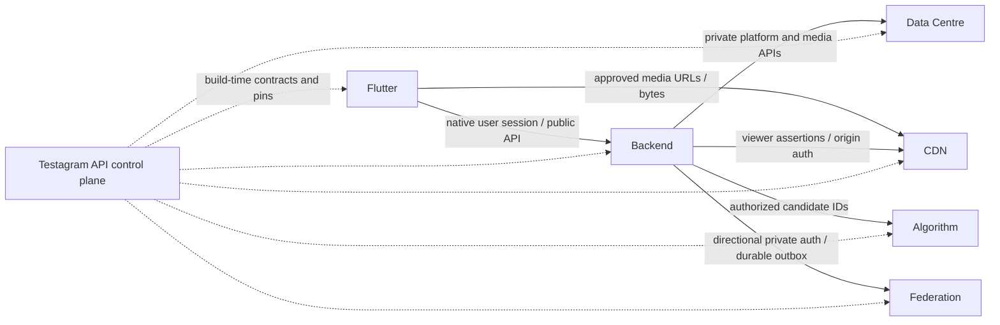

# Testagram seven-organ bridge

**Bridge branch:** `integration/seven-organ-bridge-20261120`  
**Control plane:** `Trendyzima/testagram-api`  
**Status:** source pins and static wiring audited; Backend retirement candidate and live runtime acceptance remain pending.

This repository is the build-time governance layer, not a monorepo and not a runtime gateway. The six runtime organs remain independently owned repositories. The API Control Plane coordinates their contracts, immutable source pins, generated SDKs, route inventory and compatibility checks.

## 1. Seven organs and locked source revisions

| Organ | Repository | Locked source revision | Source status |
|---|---|---|---|
| Flutter client | [testagram-flutter-client-](https://github.com/Trendyzima/testagram-flutter-client-) | `761c41b247a49aac7e9b352493465e3c321a2ffb` | Current mainline |
| Backend | [Testagram-backend-](https://github.com/Trendyzima/Testagram-backend-) | `e6fdb962c2a10159df352312e01ea05842ffde13` | Temporary native-auth PR #424 candidate; not merged |
| Data Centre | [Testagram-data-centre-](https://github.com/Trendyzima/Testagram-data-centre-) | `a22d086c03fcf8a90323dc250e53d255c7aff26c` | Current mainline |
| CDN | [cdn-](https://github.com/Trendyzima/cdn-) | `1480d9c2da6f281ed4f9caf62c37705fdbe65e9d` | Current mainline |
| Algorithm | [the-algorithm](https://github.com/Trendyzima/the-algorithm) | `92cf9b47e4de38306c4fe7b61ece24c3e075aa22` | Current mainline |
| Federation | [federated-content](https://github.com/Trendyzima/federated-content) | `3707d9a3f4e4222c23aecb8a97afbaeec45d3c5d` | Current mainline |
| Contract control plane | [testagram-api](https://github.com/Trendyzima/testagram-api) | `201fd3335c737e7fe36ed34dfa1ec07b03c31047` | Governance mainline; this bridge PR remains open |

The six runtime pins are stored in `contracts/sources.lock.json`. The Backend pin is intentionally a temporary reviewed candidate so the bridge audits the native-only code before it is merged. It must be replaced with the exact Backend mainline merge SHA after PR #424 merges. The five other runtime revisions were compared with their previous pins; intervening changes were documentation-only.

## 2. Merged organ changes represented by this baseline

- Flutter: PRs #109 and #112 (navigation and native-auth deployment documentation).
- Backend: PRs #418, #419, #421 and #423. PR #424 remains open and is not counted as merged.
- Data Centre: PRs #111 and #112 (architecture and seven-organ ownership documentation).
- CDN: PRs #122 and #123 (navigation and native media-authorization boundary documentation).
- Algorithm: PRs #27, #28 and #29 (navigation and seven-organ ownership).
- Federation: PRs #49, #50 and #51 (navigation, dependency reliability and native ownership boundary).
- API Control Plane: PR #115 (seven-organ navigation and governance graph).

The current bridge itself is PR #116. It remains open until the refreshed source-pin, SDK, route, documentation-residue and edge-wiring checks pass and the Backend candidate is independently reviewed and merged.

Two test-only residue cleanup PRs are also open:
- CDN PR #124 changes a negative authorization fixture label.
- Data Centre PR #113 changes a negative invalid-issuer fixture label.

These changes do not alter runtime behavior. Their CI and review must pass before merge.

## 3. Runtime ownership and edges



- Backend is the sole authority for Testagram identity, sessions, authorization and canonical product records.
- Flutter calls the public Backend API and approved media URLs only. It stores the rotating refresh credential in platform secure storage; short-lived access tokens remain in memory.
- Data Centre performs storage and infrastructure work. Its user-aware video and notification routes validate Backend-native JWTs and recheck PostgreSQL session/account state. Platform service credentials remain separate.
- CDN transports authorized bytes. Private viewer assertions and CDN-origin authentication are separate trust mechanisms; raw user JWTs are not forwarded as origin credentials.
- Algorithm receives bounded Backend-authorized candidate IDs and returns ranking order/reasons only. Backend rechecks authorization and hydrates canonical records.
- Federation owns protocol state and signed remote delivery. Backend owns local identity, canonical posts, consent and visibility.
- The API Control Plane validates source pins and contracts at build time. It is never a runtime hop.

## 4. Static edge-wiring acceptance

The bridge cross-repository audit now verifies the implementation on both sides of each edge, not just the topology manifest:

1. **Flutter → Backend:** native login/refresh client, secure refresh storage, in-memory access token and authenticated Backend request path.
2. **Flutter → CDN:** approved media URL handling and object/viewer-bound private-media authorization.
3. **Backend → Data Centre:** five versioned private media routes, dedicated bearer credential, request ID, bounded client timeout, redirect rejection, private Compose network and separate media database.
4. **Data Centre → Backend identity:** video and notification user-aware routes require the shared native JWT secret and resolve canonical users through PostgreSQL session/account checks.
5. **Backend → CDN:** Backend-issued short-lived viewer assertion, separate origin credential, private no-store behavior, and fail-closed origin relay.
6. **Backend → Algorithm:** dedicated service bearer, API version, request ID, bounded timeout, 200-candidate/50-result limits and matching OpenAPI enum.
7. **Backend → Federation:** distinct private ingress credential, API version, request ID, activity ID idempotency key, durable enqueue and rejection tests for missing/wrong-direction credentials.
8. **API Control Plane → six runtime organs:** immutable source pins, provider snapshots, public route inventory, SDK generation and compatibility CI only.

The static checks do not replace same-environment staging tests. Runtime reachability, secret provisioning, deployed revisions, retry behavior and failure recovery still require explicit evidence.

## 5. Media paths remain distinct

There are two separately implemented storage lifecycles and their evidence must not be mixed:

1. **Backend native virtual-storage path:** Backend-owned media metadata/replica ledger with VPS MinIO primary and R2/B2 independent replicas.
2. **Data Centre dedicated media path:** optional private media service with B2 media-byte primary and R2 verified replica. MinIO/R2 sidecars are metadata mirrors, not a third media-byte copy.

A successful upload to one provider, metadata sidecar, ETag or CDN cache hit is not proof of independent byte durability. Each lifecycle requires its own staging receipts for write, independent read-back, checksum, repair, primary-loss restore, retry and deletion tombstones.

## 6. Provider-residue audit

The expanded bridge audit scans runtime source, deployment configuration and documentation across all six runtime organs, plus the API Control Plane's public contracts and documentation. The last successful run scanned 418 runtime/deployment/configuration/documentation files and found no active external identity-provider integration.

It also found 31 occurrences isolated to an explicit migration/CI compatibility allowlist. These are old schema identifiers and negative fixtures used to prove that legacy database installations can be upgraded and that old credentials are rejected. They are not runtime authentication dependencies. The audit fails if a new occurrence appears outside that allowlist.

The compatibility residue must only be removed through a tested forward migration that preserves applied migration history and historical audit evidence. Do not delete or rewrite applied SQL migrations blindly. The allowlist and its exact file inventory are maintained in `scripts/check-native-auth-only.mjs`.

## 7. Production and security gates still open

- Backend PR #424 requires independent review and merge. Its CI is source-level evidence; its deployment job was skipped.
- Staff invitation, role-change and revocation need the complete two-person lifecycle.
- Real browser WebAuthn registration/assertion, recovery, replay rejection and revoked-credential tests remain required.
- Admin Console readiness must be verified against the deployed Backend and production-like PostgreSQL.
- Public registration and staff enrollment remain fail-closed until all gates pass.
- Production `api.testagram.site` remains associated with the legacy Worker. Deploy and health-check the native Backend origin before any custom-domain ownership transfer.
- The CDN routing workflow must implement a tested ownership transfer, DNS/TLS continuity and rollback. Do not bypass its preflight.
- Flutter production-domain, NodeInfo and WebFinger smoke acceptance remains unresolved; rerun after the correct origins are deployed.
- Run each media lifecycle against designated staging buckets, then complete an isolated coordinated restore covering Backend PostgreSQL, Data Centre media state, object bytes, Federation state and encrypted recovery material.
- Public Federation remains disabled until signed inbound verification, replay protection, SSRF controls, durable inbox/outbox, retries and independent peer interoperability pass.
- Capture exact source SHAs and immutable image digests for every deployed organ. Green CI and published images do not prove deployment.

## 8. Branch and merge policy

This bridge records reviewed source revisions; it is not an instruction to merge every branch in GitHub. A branch without a reviewed PR is not automatically merge-ready. Before merging, compare its exact tip against the organ's current main, inspect the complete diff, confirm contract ownership, run relevant checks and resolve stale/conflicting work. Preserve backup branches as recovery references; never merge them into production by default.

The Flutter production smoke PR #100 remains open and is excluded from the merge set until its live-domain failures are repaired and rerun.

## 9. Validation

Run from this repository:

```sh
npm ci
npm run sources:checkout
npm run lint:openapi
npm run lint:internal-openapi
npm run typecheck
npm run build:sdk
npm test
npm run audit:backend-routes
npm run audit:cross-repo
npm run audit:locked-acceptance
npm run audit:navigation
npm run audit:seven-organ-bridge
npm run audit:native-auth-only
dart format .
dart analyze
dart test
```

A green bridge audit proves source/contract consistency only. It does not prove live deployment, DNS/TLS ownership, production WebAuthn, media-provider durability, Federation interoperability or disaster recovery.
