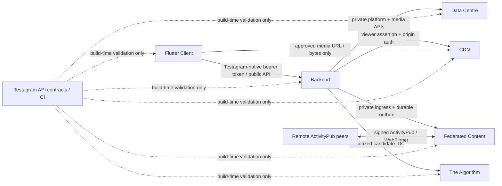

# Seven-repository navigation and runtime integration map

This page is the canonical clickable map for the seven-repository Testagram product. Six repositories run product/runtime components; this repository governs contracts, SDKs, immutable source pins and compatibility checks only.

## Repository directory

| Repository | Ownership | Primary contract / implementation references |
|---|---|---|
| [Flutter Client](https://github.com/Trendyzima/testagram-flutter-client-) | Native Android/web UI, navigation, device permissions and public API transport. It owns no canonical product records or private service credentials. | [Public Backend OpenAPI](../contracts/openapi/testagram-v1.yaml) · [Dart SDK](../packages/dart/README.md) |
| [Backend](https://github.com/Trendyzima/Testagram-backend-) | Canonical Testagram identity, native sessions, authorization, PostgreSQL product records, public APIs and service orchestration. | [Public route inventory](../contracts/route-inventory/backend-public-routes.json) · [Federation provider contract](../contracts/internal/openapi/backend-federation-provider-v1.yaml) · [TV health contract](../contracts/internal/openapi/backend-tv-health-monitor-v1.yaml) |
| [Data Centre](https://github.com/Trendyzima/Testagram-data-centre-) | Private platform services, storage/media lifecycle, processing, notifications, backups and restore operations. | [Internal platform contract](../contracts/upstream/datacentre/internal-platform.openapi.yaml) · [Media lifecycle contract](../contracts/upstream/datacentre/media-lifecycle-v1.openapi.yaml) |
| [CDN](https://github.com/Trendyzima/cdn-) | Public media byte delivery, viewer-assertion enforcement, edge routing, caching and HLS/DASH/range transport. It does not decide product visibility or ownership. | [CDN edge contract](./cdn-edge-contract.md) · [Backend viewer assertion contract](../docs/cdn-media-assertion-contract-v1.md) |
| [Federated Content](https://github.com/Trendyzima/federated-content) | WebFinger, ActivityPub actors/keys, signed ingress, protocol state and remote delivery workers. Backend remains canonical for local identity and product permissions. | [Federation ingress contract](../contracts/internal/openapi/federation-ingress-v1.yaml) · [Backend federation provider contract](../contracts/internal/openapi/backend-federation-provider-v1.yaml) · [Public ActivityPub contract](../contracts/upstream/federation/public-activitypub.openapi.yaml) |
| [The Algorithm](https://github.com/Trendyzima/the-algorithm) | Private feed ranking over Backend-authorized candidate IDs. It returns ordering/reasons only; Backend rechecks visibility and hydrates canonical records. | [Algorithm OpenAPI](../contracts/upstream/algorithm/openapi.yaml) |
| **[Testagram API](https://github.com/Trendyzima/testagram-api)** | Contract control plane: OpenAPI, private schemas, event definitions, SDKs, immutable source pins and compatibility CI. **Not a runtime service or gateway.** | [Service registry](../contracts/registry/services.json) · [Source pins](../contracts/sources.lock.json) · [Locked acceptance gates](./integration/locked-seven-repository-acceptance.md) |

## Runtime dependency graph



The dotted edges are build-time governance, never runtime network calls. There is no API-gateway hop through this repository.

## Trust boundaries and request ownership

1. **Client → Backend:** Flutter obtains Testagram-native sessions from Backend and sends short-lived access tokens to public Backend routes. Refresh credentials stay in platform secure storage. No private service URL, service token, database credential or storage-provider key belongs in the client.
2. **Backend → Data Centre:** private service credentials authenticate server-to-server calls. Data Centre owns storage mechanics and operational durability; Backend retains user authorization and canonical media/post ownership.
3. **Backend / Flutter → CDN:** Backend issues narrowly scoped, short-lived viewer assertions for private media. CDN origin authentication is a separate credential. CDN delivers bytes; it must not infer ownership or make private objects publicly cacheable.
4. **Backend → Federation:** directional private credentials are independent. Federation owns ActivityPub protocol state and signed delivery, while Backend resolves local actors and remains authoritative for local posts, consent, visibility and permissions. Remote peers connect only to public federation protocol endpoints.
5. **Backend → Algorithm:** only Backend-authorized candidate IDs and bounded ranking context cross the private boundary. The ranker returns ordered IDs/reasons; Backend rechecks access and hydrates records before the client receives content.
6. **Testagram API → runtime repositories:** CI checks immutable source pins, source snapshots, route/schema compatibility and locked acceptance criteria. It never handles user requests, identity, product data or production traffic.

## Canonical host ownership

| Host | Owner | Exposure |
|---|---|---|
| `https://testagram.site` | Flutter/web frontend | Public client |
| `https://api.testagram.site` | Backend | Public product API |
| `https://media.testagram.site` | CDN | Public media delivery with private-media viewer assertions |
| `https://federation.testagram.site` | Federated Content | WebFinger and ActivityPub protocol ingress |
| `http://platform:8095` | Data Centre platform service | Private container network only |
| `http://algorithm:8092` | Algorithm ranker | Private container network only |

Host entries document intended ownership, not proof of live DNS, TLS, routing or service readiness. Those require separate live probes and deployment evidence.

## Machine-checked invariants

Run:

```sh
npm run audit:navigation
npm run audit:cross-repo
npm run audit:locked-acceptance
```

The navigation audit checks the seven canonical repository identities, service registry consumers, contract-file targets and direct GitHub links in this document. It is intentionally offline and deterministic; it does not pretend that a URL being present proves a service is deployed or reachable.

For deployment/runtime acceptance, follow [G0–G7 locked acceptance](./integration/locked-seven-repository-acceptance.md). A gate is complete only with its specified live evidence; source pins and documentation links alone are not acceptance.
